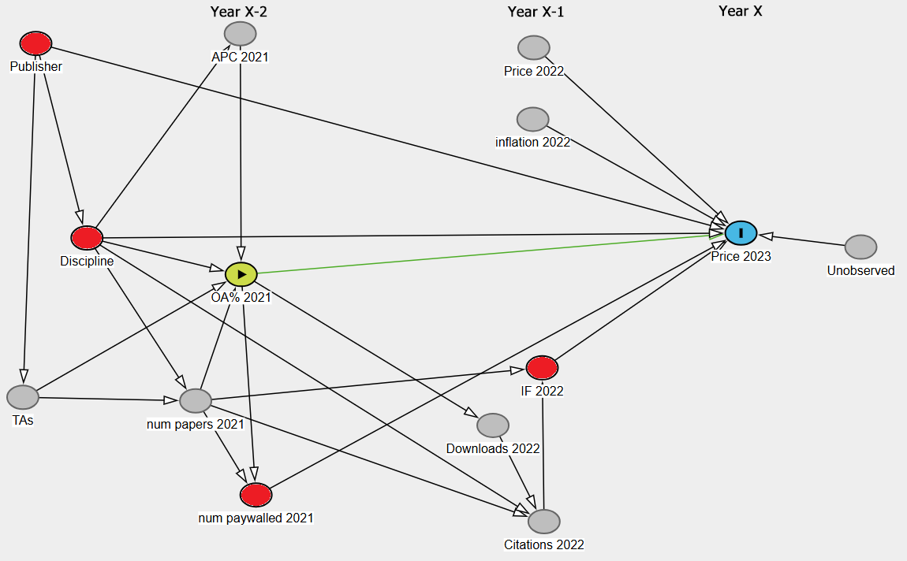

Oct. 9, 2026

# Overview

The estimand for this analysis is the direct causal effect of Open Access availability (OA%) on a hybrid journal's subscription price.

> p(Price\|do(OA))

Hybrid journals publish a mixture of:

- paywalled articles, which require a subscription to read and
- open articles, made open for anyone to read through payment of an Article Processing Charge (APC)

The exact mixture of open vs. closed content varies by journal and year.

# DAG

The DAG for this analysis is shown in @fig-DAG and also saved and available to explore on [dagitty.net](https://dagitty.net/dags.html?id=igp7575y). The direct effect of interest is shown in green, and the red nodes are the minimum adjustment set required to isolate the direct causal effect.

- Publisher (Elsevier, Wiley, etc.)
- Discipline (4 levels)
- number of paywalled articles
- Impact Factor (used as a proxy for prestige)

{#fig-DAG .lightbox}

Please note the time factor in the DAG. I have attempted to organize the nodes into columns based on year. @fig-DAG shows how the 2023 subscripton price for a journal is determined as an example. In the actual model there will repeated measurements for 7 years on each journal, 2021-2027.

Price in a given year depends on nodes from previous years. In the case of Impact Factor (IF), it is from the previous year. IF is a deterministic function that relies on the number of articles and number of citations. OA% and num articles are from year X-2. This is because subscription prices for a given year (say, 2023) are made available in August or September of the previous year (2022). Since 2022 is not over, the exact mixture of OA% or paywalled articles is not known yet, and thus could not affect the subscription price for 2023. We therefore need to go back another year to use this data.

(I know you are skeptical of lag models, especially using X-2 variables, but in this case I argue that Year-2 is only one time series ago. We don't have anything closer that would apply.)

The DAG has been inspected by several colleagues both internal and external and presented as a conference poster in Antwerp, Belgium. Small suggestions were made but overall the reception was good. I am reasonably confident in this adjustment set.

# Analysis

Remember to clean and refresh Environment

## Load libraries

```{r message = FALSE, warning = FALSE}
library(tidyverse)
library(rethinking)
#library(marginaleffects)  # for interpreting model results
library(ggridges)         # for ridge plots
```

# Simulate synthetic journals

Currently, I am simulating synthetic data for OA vs. Price with:

- 2x2 matrix of alphas for 2 Publisher and 2 Discipline levels $\alpha_{pd}$ (like the UCB Admission example, SR 2026 A09 41:00)

- Journal specific intercept $\alpha_j$

- Number of paywalled articles

- IF

- Price as a lognormal distribution in the likelihood

- standardized predictor variables OA, num_art, and IF

- multilevel structure: each journal is measured 7 times, once per year

## Will still need to add:

- 2 more Discipline levels for 4 total

- a beta for each Pub_Disc separately? 3 betas \* 8 Pub_Disc levels (2x4) = 24 beta coefficients?? Maybe just each publisher separately

- do I standardize the outcome variable, price?

- standardize the combined alpha too? Then how would I get up to values like \$3,000? Betas will be huge

```{r sim_journals}

sim_journals_lognormal_multilevel <- function(
    J = 50,             # number of journals
    num_years = 7,    # number of years per journal
    
                    # P1D1, P1D2, P2D1, P2D2; 
                    # Pub 1->2 -1000; Disc 1->2 +500
    a_pub = c(log(2000), log(2500), log(1000), log(1500)),   # Publisher Discipline baselines
    
    #inflation = 0.03,       # persistent 3% YoY inflation
    #b_OA = -0.05,       # -5% price shift with 1 SD increase in OA
    b_articles = 0.15,  # +15% price shift with 1 SD increase in volume
    b_IF = 0.25,        # 25% price increase with 1SD increase of IF
    sigma = 0.2
    ) {
  
  #### Individual Journal properties ####
  
  Publisher_j <- rbern(J, 0.5) + 1         # 2 levels, 1 or 2
  
  # DAG shows Discipline depends on Publisher
  prob_disc   <- ifelse(Publisher_j == 1, 0.6, 0.3)
  Disc_j      <- rbern(J, prob_disc) + 1   # 2 levels, 1 or 2
  

  # Combined index for alpha 1-4: 1=(P1,D1), 2=(P1,D2), 3=(P2,D1), 4=(P2,D2)
  Pub_Disc_j  <- ifelse(Publisher_j == 1, 
                     ifelse(Disc_j == 1, 1, 2), 
                     ifelse(Disc_j == 1, 3, 4))
  
  # Random variation in journals, a specific offset
  a_journal_j <- rnorm(J, 0, 0.5)   #0.7, 0.25, -0.12, etc.
  
  
  #### Journals across years ####
  
  journal_id <- rep(1:J, each = num_years)     # repeats in blocks: 1, 1, 1, 2, 2, 2, etc
  year       <- rep(1:num_years, times = J)    # repeats in series: 1, 2, 3, 1, 2, 3
  N          <- J * num_years                  # rows
  
  # Repeat journal static characteristics across years
  Publisher <- Publisher_j[journal_id]         # using journal_id repeats the descriptor in blocks
  Disc      <- Disc_j[journal_id]
  Pub_Disc  <- Pub_Disc_j[journal_id]
  a_journal <- a_journal_j[journal_id]
  
  
  #### Time varying predictors, N observations
  
  # OA depends on Discipline (1 or 2)
  OA_raw  <- rnorm(N, ifelse(Disc == 1, 20, 30), 10)
  OA_raw  <- pmax(0, OA_raw)   # set floor to 0%
  
  # Articles depends on OA%
  art_raw <- rnorm(N, 1200, 500)
  art_raw <- pmax(10, art_raw * ( (100 - OA_raw) / 100) )  # set floor to 10 articles
  
  # IF depends on nothing, use a LogNormal distribution
  IF_raw <- rlnorm(N, meanlog = log(2.5), sdlog = 0.8)
  log_IF <- log(IF_raw)      # approx normal with mean log(2.5)
  
  # Standardize predictors across entire dataset, not just within each year!
  z_OA        <- standardize(OA_raw)
  z_articles  <- standardize(art_raw)
  z_IF        <- standardize(log_IF)
  
  # OA effect varies by publisher
  b_OA = c(-0.05, 0.05)       # -5% price shift with 1 SD increase in OA

  
  # use standardized predictors
  log_mu <- a_pub[Pub_Disc] +
            a_journal +
            b_OA[Publisher] * z_OA +
            b_articles * z_articles +
            b_IF * z_IF 
            #rnorm(N, 0, 1) 
  
  
  Price <- exp(log_mu)                    # wait, do we take exp(log_mu) exactly,
  #Price <- rlnorm(N, log_mu, sigma)      # or a draw from a LogNormal with that mean??
                                          # would add a whole nother level of variation
  
  data.frame(journal_id, a_journal, year, Publisher, Disc, Pub_Disc, sigma, OA_raw, z_OA, art_raw, z_articles, IF_raw, log_IF, z_IF, log_mu, Price)

}


dat <- sim_journals_lognormal_multilevel( )

# If the price of a journal should only go up year over year:
dat <- dat |> 
  group_by(journal_id) |> 
  mutate(
    adjusted_price = Reduce(
      f = function(prev, curr) max(curr, prev * 1.03),   # compare current price to 3% inflation over last year's
      x = Price,
      accumulate = TRUE
    )
  ) |> 
  ungroup()

head(dat)
```

Summarize it

```{r summarize_it}
dat |> 
  summarize(n_rows = n(),
            n_journals = n() / 7,
            meanOA = mean(OA_raw),
            meanPrice = mean(Price),
            meanArticles = mean(art_raw),
            minArticles = min(art_raw),
            maxArticles = max(art_raw),
            meanIF = mean(IF_raw),
            .by = c(Publisher, Disc, Pub_Disc)) |> 
  arrange(Pub_Disc)

# ggplot(data.frame(Publisher, Disc), aes(x = Publisher, y = Disc)) + 
#   geom_point()
```

Graph it

```{r}
dat |> 
  ggplot(aes(x = Price)) + 
    geom_density(aes(colour = as.factor(journal_id)))
  #facet_wrap(~journal_id)
```

```{r first-5-journals}
# First 5 journals
dat |> 
  slice_head(n=7*5) |> 
  ggplot(aes(x = year, y = Price)) + 
    geom_point(aes(colour = z_OA)) +
  facet_wrap(~journal_id)
```

```{r density-plots include=FALSE}

# Price
# OA
# num_articles
# IF

# Price
dat |> 
  ggplot(aes(x = Price,
             y = as.factor(Pub_Disc),
             fill = as.factor(Publisher)
             )
         ) + 
 geom_density_ridges() +
    theme_ridges() 

# OA
dat |> 
  ggplot(aes(x = OA_raw,
             y = as.factor(Pub_Disc),
             fill = as.factor(Publisher)
             )
         ) + 
 geom_density_ridges() +
    theme_ridges()

# OA standardized
dat |> 
  ggplot(aes(x = z_OA,
             y = as.factor(Pub_Disc),
             fill = as.factor(Publisher)
             )
         ) + 
 geom_density_ridges() +
    theme_ridges()


# num_articles
dat |> 
  ggplot(aes(x = art_raw,
             y = as.factor(Pub_Disc),
             fill = as.factor(Publisher)
             )
         ) + 
 geom_density_ridges() +
    theme_ridges()

# num_articles standardized
dat |> 
  ggplot(aes(x = z_articles,
             y = as.factor(Pub_Disc),
             fill = as.factor(Publisher)
             )
         ) + 
 geom_density_ridges() +
    theme_ridges()

# IF
dat |> 
  ggplot(aes(x = IF_raw,
             y = as.factor(Pub_Disc),
             fill = as.factor(Publisher)
             )
         ) + 
 geom_density_ridges() +
    theme_ridges()

# log(IF)
dat |> 
  ggplot(aes(x = log_IF,
             y = as.factor(Pub_Disc),
             fill = as.factor(Publisher)
             )
         ) + 
 geom_density_ridges() +
    theme_ridges()

# IF standardized
dat |> 
  ggplot(aes(x = z_IF,
             y = as.factor(Pub_Disc),
             fill = as.factor(Publisher)
             )
         ) + 
 geom_density_ridges() +
    theme_ridges()

```

```{r include=FALSE}
transform(dat, 
          fct = cut(art_raw, seq(0, 5000, 500))
          ) |> 
  
  ggplot(aes(x = OA_raw, y = adjusted_price)) +
  geom_point(aes(colour = as.factor(Publisher))) +
  
  #facet_wrap(~Disc ) +
  
  facet_grid(rows = vars(Pub_Disc), cols = vars(fct)) +
  
  labs(title = 'Rows are Pub_Disc indexes',
       subtitle = 'Cols are number of articles')


```

# Prior predictive distribution

```{r include=FALSE}
# For standardized variables
e <- 20
a <- rnorm(e, 0, 0.2 )
bA <- rnorm(e, 0, 0.5)

plot(NULL, xlim=c(-2,2), ylim=c(-2,2),
xlab='Standardized',
ylab='Standardized')

Aseq <- seq(from=-3, to=3, len=30)

for( i in 1:e ) {
  mu <- a[i] + bA[i]*Aseq
  lines( Aseq, mu, lwd=2, col=2)
}
```

```{r prior-predictive}
# Think about plausible ranges of each parameter

n <- 1e3

a_pub_disc  <- rnorm(n, 7.5, 1)    # Publisher intercept at mean OA (20%), mean num articles (1000), mean IF (2.5)

a_journal_j <- rnorm(n, 0, 0.5)    #95% -1 to 1

# sd(dat$OA_raw)    # 11
# sd(dat$art_raw)   # 400
# sd(dat$IF_raw)    # 1.5
# 
# mean(dat$OA_raw)   # 20
# mean(dat$art_raw)  # 1000
# mean(dat$IF_raw)   # 2.5
# mean(dat$Price)    # 1500
 
# 0, 0.2 means 95% between -40% and +40%
b_OA   <- rnorm(n, 0, 0.2)       # OA effect, $ change per 1SD in OA
b_art  <- rnorm(n, 0, 0.2)       # volume effect, $ change per 1SD in articles
b_IF   <- rnorm(n, 0, 0.2)


OA_seq <- seq(-3, 3, length.out = 60)
art_ref <- 0     # taking average article
IF_ref  <- 0     # Impact Factor at average


plot(NULL, xlim = c(-3, 3),
           ylim = c(-500, 7000),
           xlab = "OA% Standardized (1SD = 11%)", ylab = "Price ($)", main = "Prior Predictive Distribution")

for (j in 1:50) {
  log_mu <- a_pub_disc[j] + 
        a_journal_j[j] + 
        b_OA[j] * OA_seq +
        b_art[j] * art_ref +  # standardized priors, get zero'd out
        b_IF[j] * IF_ref
  
  lines( OA_seq, exp(log_mu),
         lwd = 1.5, col = 2)
  
}

abline(h = 0, lty = 2, col = "red")

```

# Run Model

Run the model to estimate the parameters. Converted alpha model to a matrix of \[Pub, Disc\]. Requires some downstream edits to process.

Add multi-level priors on the alpha intercept

Add journal parameter to remember that we have repeated measurements on each journal

```{r ulam}
m4.10 <- ulam(
  alist( 
    #adjusted_price ~ dlnorm(log(mu), sigma),     # for price that only goes up
    Price ~ dlnorm(mu, sigma),
    
    mu <- a[Publisher, Disc] + 
          a_journal_est[journal_id] +
          b_OA[Publisher] * z_OA +
          b_articles * z_articles +
          b_IF * z_IF,
    
    matrix[Publisher, Disc]:a ~ dnorm(abar, zigma),     
    
    abar ~ dnorm(7.5, 1),    # Global intercept at mean OA, articles, and IF, exp(7.5) = $1800
    zigma ~ dexp(1),
    
    a_journal_est[journal_id] ~ dnorm(0, 0.5),
    b_OA[Publisher] ~ dnorm(0, 0.2),                    # $ change per 1 SD OA
    b_articles ~ dnorm(0, 0.2),              # $ change per 1 SD articles
    b_IF ~ dlnorm(0, 0.2),                   # $ change per 1 SD in IF
    
    sigma ~ dexp(1) 
    
  ), data=dat, chains=4, cores=4, log_lik = TRUE
)
```

## Check parameters

```{r precis}
precis(m4.10, depth = 3)
```